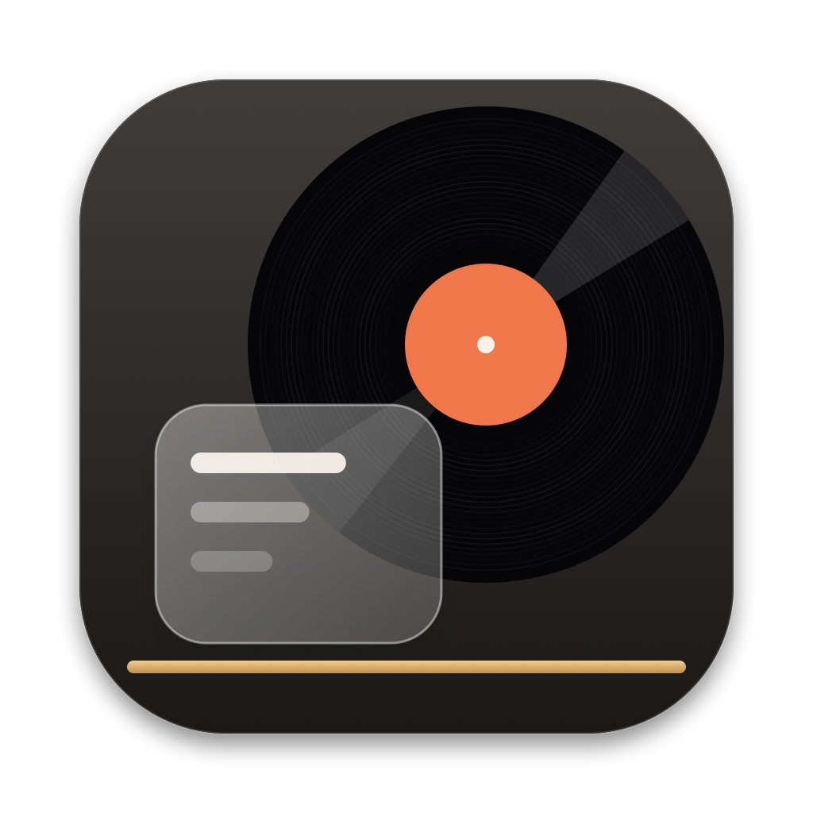
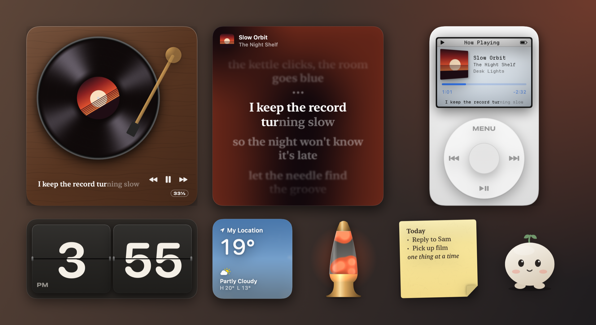
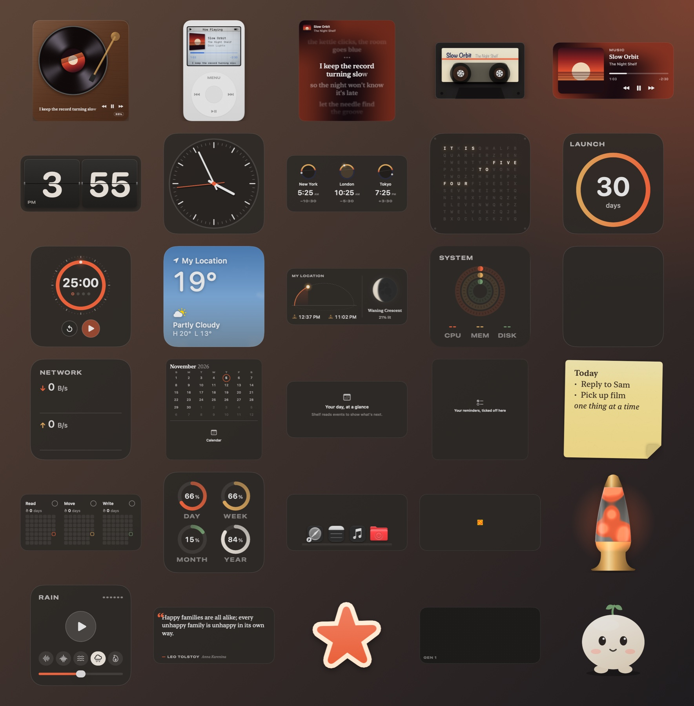

<div align="center">
  
  <h1>Shelf</h1>
  <p><b>Desktop widgets for your Mac, with a turntable that spins to your music</b></p>

  [](https://github.com/shorielol/shelf/releases/latest)
  
  [](LICENSE)
</div>

<br>



Shelf puts widgets straight onto your desktop, above the icons and below every window, on every Space. The music widgets are the reason it exists. A record player spins at 33⅓ while Music or Spotify plays and its tonearm creeps toward the label as the song goes on, a pocket player has a click wheel you can turn for volume, and synced lyrics light up word by word.

## Install

Download `Shelf.zip` from the [latest release](https://github.com/shorielol/shelf/releases/latest), unzip it and move Shelf to your Applications folder.

The app isn't notarized yet, so macOS will stop it the first time. Open **System Settings → Privacy & Security**, scroll down and click **Open Anyway**. Or in Terminal:

```sh
xattr -dr com.apple.quarantine /Applications/Shelf.app
```

Shelf needs macOS 26 Tahoe or later, because the widgets are drawn with Liquid Glass.

## The widgets

| Group | Widgets |
| --- | --- |
| Music | Turntable, Click Wheel, Lyrics, Cassette, Now Playing |
| Time | Flip Clock, Analog Clock (minimal, railway, Bauhaus), World Clocks, Word Clock, Countdown, Focus Timer |
| Info | Weather, Sun & Moon, System Monitor, Battery, Network |
| Productivity | Calendar, Up Next, Reminders, Sticky Note, Habit Grid, Day Progress, Launcher |
| Ambient | Photo Frame, Lava Lamp, Ambient Sound, Quote of the Day, Stickers, Game of Life, Desk Buddy |



A few details worth knowing about:

- The turntable's platter angle comes from the playback position, so pausing makes the record coast to a stop over about a second and a half instead of freezing. Drag the tonearm to seek.
- The click wheel changes volume by one step for every 15° you turn it, with a tick and trackpad haptics. MENU switches between Now Playing, Lyrics and a cover view.
- The cassette's reels turn at the speed real tape would make them: the fuller reel turns slower, and the tape moves from left to right over the length of the song.
- Lyrics come from [LRCLIB](https://lrclib.net). When a song has word-level timing the highlight follows each word; otherwise it sweeps across the line at a natural reading pace. If the lyrics run early or late, nudge them in Settings.
- The flip clock folds its cards on a hinge, the railway clock's second hand sweeps round in 58.5 seconds and waits at twelve, and the word clock spells the time in a grid of letters.
- Weather draws its own sky (rain, snow, fog, a thunderstorm) and works from your location or a city you type in.
- Ambient Sound makes its rain, fireplace and coloured noise in real time, so there are no loops to hear repeating. Desk Buddy is a small round creature that watches your cursor and gets sleepy after 10 pm.

## Using it

Click the Shelf icon in the menu bar and choose **Edit Widgets**. Drag widgets around, pull the corner handle to resize, and click **Add Widget** to open the gallery. Positions snap to an 8-point grid unless you switch snapping off. Right-click any widget for its size, its settings, Lock Position and Remove.

The first launch plays a short welcome and offers three starting layouts: Listening Room, Focus Desk and Minimal. You can replay it from the menu bar.

`shelf://edit`, `shelf://add` and `shelf://welcome` open edit mode, the gallery and the welcome tour, which is handy from Shortcuts or a launcher.

## Privacy

There are no accounts and no analytics. Shelf makes these network requests and no others:

- [LRCLIB](https://lrclib.net) for lyrics, sending the title, artist, album and length of the song that's playing. It only asks while a widget that shows lyrics is on your desktop, and each answer is cached in `~/Library/Application Support/Shelf/Lyrics`.
- [Open-Meteo](https://open-meteo.com) for the forecast and for turning a typed city into coordinates.
- Spotify's own image server for album art, when Spotify is the player.

macOS will ask before Shelf reads Music or Spotify (Automation), your calendars, your reminders or your location. Each permission only matters to the widgets that use it, and every one of them can be refused.

## Limitations

- Music and Spotify are the only players it reads. Browser tabs, Apple TV and podcast apps don't show up yet.
- Widgets live on the desktop, so they're hidden behind full-screen apps and windows like anything else on the desktop.
- Battery shows a placeholder on Macs without one, and Calendar, Up Next and Reminders stay empty until you allow access.
- Identical monitors with the same name and resolution can't yet be told apart, so their widgets share a layout.

## FAQ

**Is the click wheel an iPod?**
It's a homage to one. The body, wheel and screen are drawn from scratch in SwiftUI, and there's no Apple logo or artwork in the app.

**Why does macOS ask to let Shelf control Music?**
That's how the music widgets read the current track and send play, pause, skip and volume. Without it the music widgets show "nothing playing" and everything else still works.

**Where's my layout saved?**
In `~/Library/Application Support/Shelf/layout.json`. If that file ever can't be read, Shelf moves it into the `Backups` folder next to it rather than overwriting it.

**Can I turn off the sounds?**
Yes, in Settings. Every sound (the wheel tick, the needle drop, the flap clack) is synthesised by the app when it starts, so no audio files ship with it.

## Building from source

You need Xcode 26 and [XcodeGen](https://github.com/yonaskolb/XcodeGen).

```sh
brew install xcodegen
make project   # generates Shelf.xcodeproj from project.yml
make build     # Release build into .build/xcode
make test      # ShelfCore tests with coverage
make release   # zips the app into dist/Shelf.zip
```

`Shelf --snapshot <folder>` renders every widget at each of its sizes to PNG and quits without touching the desktop. The gallery image above comes from it.

```
App/Shelf/
  App/          entry point, menu bar, settings, app model, snapshot renderer
  Desktop/      one panel per widget, edit mode, the gallery and inspector
  Media/        Music and Spotify bridge, lyrics, weather, system stats
  Onboarding/   the welcome sequence and starter layouts
  Widgets/      one folder per group, one file per widget
  Effects/      Metal shaders (vinyl, weather sky, lava lamp, LCD, contour lines)
Packages/ShelfCore/   lyrics parsing and timing, the LRCLIB client, playback clock,
                      layout and snapping, sun and moon maths, physics, meters
```

## Credits

- [Departure Mono](https://departuremono.com) by Helena Zhang, the pixel font on the click wheel's screen, under the SIL Open Font License 1.1 (`App/Shelf/Resources/Fonts/DepartureMono-LICENSE.txt`).
- Weather data by [Open-Meteo](https://open-meteo.com), licensed CC BY 4.0.
- Lyrics from [LRCLIB](https://lrclib.net), a free community database.
- Word clock, flip clock and cassette designs are long-standing genres; the versions here were drawn for Shelf.

## License

MIT. See [LICENSE](LICENSE).
